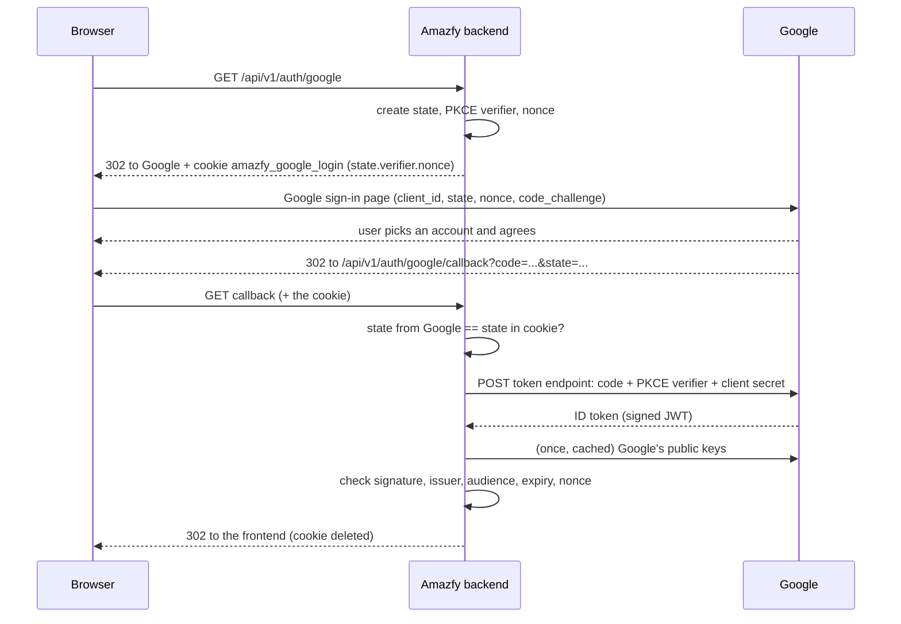

# Google login: how it is implemented

How "Sign in with Google" works inside Amazfy: the flow, the security values, and how the ID token from Google is checked. For the Google Cloud setup (project, consent screen, client ID and secret) see [Google login setup](google-login-setup.md).

Status: the round trip and the token check are built (M1, Google login parts 1 and 2). Finding or creating the Amazfy user and logging them in is part 3.

## The big picture

"Sign in with Google" uses **OpenID Connect (OIDC)**, a standard layer on top of OAuth 2.0. We use the **authorization code flow with PKCE**, the recommended flow for web apps with a backend.

The browser travels Amazfy → Google → Amazfy. The important part happens at the end, **server to server**: our backend asks Google directly for a signed statement about who signed in, so the browser never carries anything we have to trust blindly.



## Where the code lives

| Part | File | Role |
| --- | --- | --- |
| Endpoints | `auth/adapter/inbound/web/AuthController.kt` | `startGoogleLogin` and `completeGoogleLogin`: cookie in, cookie out, redirects |
| Flow logic | `auth/application/GoogleLoginService.kt` | `start()` creates the three secrets; `complete()` checks the state and asks for the identity |
| Port | `auth/application/port/AuthPorts.kt` → `GoogleIdentityProvider` | What the application needs from Google, without knowing how |
| Google adapter | `auth/adapter/outbound/google/GoogleOidcProvider.kt` | Builds the sign-in URL, calls Google's token endpoint, checks the ID token |
| Result | `auth/domain/GoogleIdentity.kt` | Who Google says signed in; `GoogleLoginFailedException` |
| Settings | `application.properties`, `application-local.properties`, `backend/secrets-local.properties` (git-ignored) | Client ID, secret, redirect URI, Google's endpoints |
| Contract | `api/openapi.yaml` → `/api/v1/auth/google`, `/api/v1/auth/google/callback` | Both are browser navigations (302), not fetch calls |

Like the rest of the backend, the application layer talks to Google only through the port, so tests can replace Google with a fake and a future identity provider can reuse the same flow.

## Step 1: start (`GET /api/v1/auth/google`)

`GoogleLoginService.start()` creates three random values (32 random bytes each, from `SecretTokenCodec.newToken()`):

| Value | Sent to Google as | Why it exists | Attack it stops |
| --- | --- | --- | --- |
| **state** | `state` | Google returns it unchanged; we compare it with our cookie | **CSRF / login forcing**: another site sends your browser to our callback with *its* code, logging you into the attacker's account |
| **PKCE code verifier** | only its hash, `code_challenge` (SHA-256, base64url) with `code_challenge_method=S256` | When exchanging the code we must present the original verifier, which only we know | **Stolen code**: a code intercepted on the way back (logs, browser history, a malicious extension) is useless without the verifier |
| **nonce** | `nonce` | Google copies it into the ID token; we check it there | **Token replay**: an ID token from another sign-in can't be passed off as this one |

The three values wait in the cookie **`amazfy_google_login`** (`state.verifier.nonce`) until Google sends the browser back:

| Cookie attribute | Value | Why |
| --- | --- | --- |
| `HttpOnly` | yes | Page scripts can't read it |
| `Secure` | yes (except locally) | Only sent over HTTPS |
| `SameSite` | **Lax** | Must be sent when Google redirects the browser back to us (a top-level navigation from another site). `Strict` would drop it and every sign-in would fail. |
| `Path` | `/api/v1/auth/google` | Only the Google endpoints receive it |
| `Max-Age` | 10 minutes | A sign-in left open longer simply fails |

Then a **302 redirect** to `https://accounts.google.com/o/oauth2/v2/auth` with `client_id`, `redirect_uri`, `response_type=code`, `scope=openid email profile`, `state`, `nonce`, `code_challenge`, `code_challenge_method=S256` and `prompt=select_account` (always show the account picker).

Without a configured client ID, `start()` throws `NotImplementedYetException` → **501** "Google login is not available yet."

## Step 2: Google

The user picks a Google account and agrees to share their basic profile. Google then redirects the browser to our **redirect URI**, which must be registered in Google Cloud exactly:

- success: `.../callback?code=4/0Ab...&state=<our state>`
- the user pressed Cancel: `.../callback?error=access_denied&state=<our state>` (no code)

The `code` is single-use and short-lived (minutes). On its own it proves nothing; it has to be exchanged.

## Step 3: callback (`GET /api/v1/auth/google/callback`)

`AuthController.completeGoogleLogin` reads the cookie back into a `GoogleRoundTrip` and calls `GoogleLoginService.complete()`, which checks in this order:

1. `error=access_denied` → **cancelled** (`GoogleSignInCancelledException`), not an error.
2. No cookie (expired after 10 minutes, or the flow started in another browser) → fail.
3. **State check**: the `state` from the URL must equal the cookie's state. Compared with `MessageDigest.isEqual`, which takes the same time however many characters match, so timing reveals nothing. Mismatch → fail, **before** contacting Google.
4. Any other `error`, or no `code` → fail.
5. Ask the adapter to exchange the code and verify the token (steps 4 and 5 below).

Whatever happens, the response deletes the cookie (`Max-Age=0`), so each sign-in attempt can be completed only once.

## Step 4: code exchange (server to server)

`GoogleOidcProvider.requestIdToken` sends a form `POST` to `https://oauth2.googleapis.com/token`:

| Field | Value |
| --- | --- |
| `grant_type` | `authorization_code` |
| `code` | the code from the callback |
| `code_verifier` | the PKCE verifier from the cookie (Google hashes it and compares with the `code_challenge` it got in step 1) |
| `client_id`, `client_secret` | our OAuth client (the secret proves the request comes from Amazfy's backend) |
| `redirect_uri` | must be the same as in step 1 |

Google answers with JSON containing an **`id_token`** (and an access token we don't use). A refused code (already used, expired, wrong verifier) or an unreachable Google → `GoogleLoginFailedException`. The logged reason never includes the secret.

## Step 5: the ID token check

This is the heart of the security: everything we later decide (which user to log in) rests on this token being genuine.

### What an ID token is

A **JWT** (JSON Web Token): three base64url parts joined by dots, `header.payload.signature`.

- **Header** says how it was signed and with which key:

  ```json
  { "alg": "RS256", "kid": "a1b2c3...", "typ": "JWT" }
  ```

- **Payload** holds the **claims** (statements) about the sign-in:

  ```json
  {
    "iss": "https://accounts.google.com",
    "aud": "1234567890-abc.apps.googleusercontent.com",
    "sub": "109876543210987654321",
    "email": "john@gmail.com",
    "email_verified": true,
    "name": "John Seller",
    "nonce": "kq3J9x...",
    "iat": 1760400000,
    "exp": 1760403600
  }
  ```

- **Signature**: Google signs `header.payload` with its **private key** (RSA, algorithm RS256). Anyone can check the signature with Google's **public key**, but only Google can create it. Changing a single character of the payload (say, the email) breaks the signature.

Anyone can *read* a JWT (paste one into jwt.io); the signature is what makes it *trustworthy*.

### The checks, one by one

All happen in `GoogleOidcProvider`. A failure in any of them → `GoogleLoginFailedException`, logged with the reason.

| # | Check | How | Stops |
| --- | --- | --- | --- |
| 1 | **Signature** | `NimbusJwtDecoder.withJwkSetUri(...)` downloads Google's public keys (a **JWK set** from `https://www.googleapis.com/oauth2/v3/certs`), picks the key named by the header's `kid`, verifies the RS256 signature. Keys are cached and re-fetched when Google rotates them (a new `kid` appears). | Forged or modified tokens |
| 2 | **Issuer** (`iss`) | Must be `https://accounts.google.com` or `accounts.google.com` (Google uses both) | Tokens from any other issuer |
| 3 | **Audience** (`aud`) | Must contain **our** client ID | A genuine Google token issued to *another* app: a malicious app could otherwise sign its users in to Google and replay their tokens to us |
| 4 | **Expiry** (`exp`, `iat`) | `JwtTimestampValidator`: not expired (60 seconds of clock tolerance) | Old tokens |
| 5 | **Nonce** | The `nonce` claim must equal the cookie's nonce | Replaying a token from a different sign-in |
| 6 | **Subject and email present** | `sub` must exist; `email` must exist | Tokens we can't map to a person |

Checks 1–4 are configured once on the decoder (`setJwtValidator(...)`); check 5 is per sign-in, so it runs after decoding.

### What we take from the token

`GoogleIdentity(subject, email, emailVerified, name)`:

- **`subject`** (`sub`): Google's permanent ID for the person. It **never changes**, while the email can (people rename accounts). That's why Amazfy will match Google logins by subject, stored in `user_identities (provider = 'google', subject)`, not by email.
- **`email`, `emailVerified`**: Google says whether it verified the address. Part 3 links a Google login to an existing password user with the same email **only if** `email_verified` is true.
- **`name`**: for display only.

We never store Google's tokens: the ID token is used once and dropped. (Google Ads access, M4, is a separate consent with its own stored, encrypted token.)

## Where the browser ends up

| Outcome | Redirect | Shown to the user (frontend pages, end of M1) |
| --- | --- | --- |
| Signed in (part 3) | frontend home, or onboarding for a new user | — |
| Cancelled on Google's page | `{FRONTEND_BASE_URL}/login` | nothing; it was their choice |
| Any failure | `{FRONTEND_BASE_URL}/login?error=google` | a generic "Google sign-in failed, please try again" (the reason stays in the backend log, so attackers learn nothing) |

Until part 3 exists, a fully verified sign-in ends with **501** "Google login is not available yet."

## Settings

| Setting | Local | Production |
| --- | --- | --- |
| `GOOGLE_CLIENT_ID`, `GOOGLE_CLIENT_SECRET` | `backend/secrets-local.properties` (git-ignored) | hosting platform secrets |
| `GOOGLE_REDIRECT_URI` | `http://localhost:8080/api/v1/auth/google/callback` (in `application-local.properties`) | the real `https://` callback, registered in Google Cloud |
| `amazfy.google.token-uri`, `amazfy.google.jwk-set-uri` | Google's fixed addresses (in `application.properties`); tests point them at a fake | same |
| `FRONTEND_BASE_URL` | `http://localhost:5173` | the frontend's address |

Without a client ID, Google login is simply off (501); the rest of the backend works normally.

## How it is tested

| Test | What it proves |
| --- | --- |
| `GoogleOidcProviderTest` | The real adapter against a **fake Google**: a local HTTP server (JDK `HttpServer`) with a token endpoint and a JWK set, signing ID tokens with its own RSA key. Valid token accepted; wrong nonce, wrong audience, wrong issuer, expired token, a token signed by a different key with the same `kid`, and a refused code are all rejected. Also checks the exchange sends code, PKCE verifier and client credentials. |
| `GoogleLoginServiceTest` | State mismatch is rejected **before** Google is called; missing cookie fails; Cancel is reported as cancelled; verifier and nonce from the cookie reach the exchange. |
| `GoogleLoginEndpointsTest` | The redirect to Google (all parameters, cookie attributes, challenge = SHA-256 of the cookie's verifier); callback without cookie, with forged state, and after Cancel redirect to the right frontend page and delete the cookie. |

Tests never call the real Google. To try the real thing, follow the setup guide and open http://localhost:8080/api/v1/auth/google in a browser.

## Glossary

| Term | Meaning |
| --- | --- |
| **OAuth 2.0** | A standard for letting an app get limited access on a user's behalf, without their password |
| **OpenID Connect (OIDC)** | Login on top of OAuth 2.0: adds the ID token that says *who* the user is |
| **Client ID / secret** | Our app's public name and private password at Google |
| **Redirect URI** | Where Google may send the browser back; registered in advance so codes can't be sent elsewhere |
| **Authorization code** | Single-use ticket Google gives the browser, exchanged by our backend for tokens |
| **PKCE** | "Proof Key for Code Exchange": the verifier/challenge pair that makes a stolen code useless |
| **ID token** | Signed JWT from Google stating who signed in |
| **JWT** | JSON Web Token: `header.payload.signature`, readable by anyone, trustworthy only through its signature |
| **JWK set** | A provider's published public keys, used to check its signatures |
| **Claim** | One statement in a JWT payload (`iss`, `aud`, `sub`, `email`, `exp`, `nonce`, ...) |
| **`kid`** | Key ID in the JWT header: which of the provider's keys signed it |
